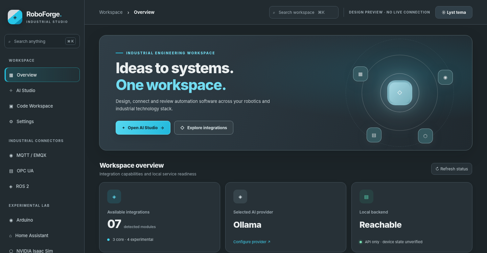
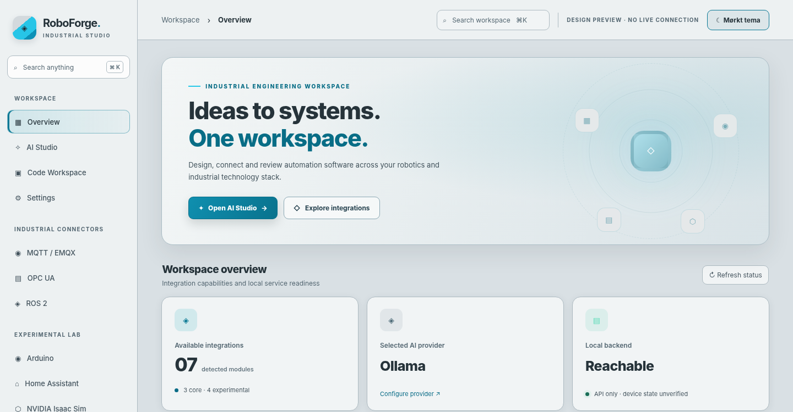

<div align="center">


# RoboForge Studio

**Industrial engineering workbench · Robotics · AI-assisted development · Protocol integrations**

A local-first workspace for exploring robot software, industrial interfaces and AI-generated code—with explicit operator approval before actions are sent to connected systems.

[](CHANGELOG.md)
[](LICENSE)
[](#integration-matrix)
[](#chromaneural-module-9--optional-mcp-gateway-v040)

[Explore the project website](https://janus5g.github.io/RoboForge/) ·
[Get started](#quick-start) ·
[Integrations](#integration-matrix) ·
[MCP Gateway](#chromaneural-module-9--optional-mcp-gateway-v040)

</div>

---

## Interface preview

The owner-approved design pairs **graphite, silver and cyan** in two selectable appearances. The app's theme preference is retained locally.

| Dark appearance | Light appearance |
| :---: | :---: |
|  |  |

> **Screenshot provenance:** The two images above are **static design previews**, not screenshots of a fully verified running React application. Displayed API/device labels are illustrative. See [visual evidence notes](docs/screenshots/README.md). A React/Vite runtime screenshot should replace them after an end-to-end build and launch check.

## What can RoboForge be used for?

RoboForge brings a common workspace to several engineering workflows:

- **Robot application prototyping:** inspect ROS 2 topics and node information through a separately running rosbridge service; review manually authorized publications.
- **Factory and PLC observability:** browse and read OPC UA values from a specifically configured local endpoint, subject to the optional native driver and site security policy.
- **IoT telemetry exploration:** inspect MQTT traffic over WebSocket, subscribe to selected topics and publish only after explicit confirmation.
- **AI-assisted code drafts:** request code using a local Ollama model or an explicitly selected external provider; inspect the result in the code workspace before using it elsewhere.
- **Simulation experiments:** inspect Isaac Sim-related ROS 2 `/clock` telemetry, without assuming scene control or an active simulator.
- **Embedded device experiments:** inspect permitted serial streams from compatible boards in a Web Serial-capable browser; firmware flashing is deliberately not implemented.
- **Home automation exploration:** inspect Home Assistant entity and automation state using a user-authorized WebSocket connection.
- **Software reverse engineering:** use the optional REA CLI bridge to inspect the structure and metadata of authorized JS/Electron, .NET, Go or Rust artifacts without executing the analyzed program.

The [public project website](https://janus5g.github.io/RoboForge/) explains these scenarios in more detail. Its source is available at `docs/index.html`.

## Integration matrix

| Integration | Current functionality | Read/write policy | Verification boundary |
| --- | --- | --- | --- |
| **ROS 2** | Connect to rosbridge; list nodes/topics and subscribe to selected messages | Publish only with explicit confirmation | Requires working rosbridge/rosapi; no physical robot validation |
| **OPC UA** | Browse address space and read values with optional `node-opcua-client` | Read-only | Local endpoint only by default; industrial trust/certificates not validated |
| **MQTT / EMQX** | Connect using MQTT over WebSocket, subscribe, inspect, publish | Explicitly confirmed publish | Requires separately configured broker and permissions |
| **NVIDIA Isaac Sim** | Observe `/clock` through ROS 2 | Monitoring only | Experimental; no scene streaming/control |
| **Siemens Xcelerator** | Configured API-backed HTTPS JSON GET inspection | Read-only | Experimental; requires product-specific API, authorized tenant and token |
| **Arduino** | Permission-gated serial monitor | Monitoring; no flash | Experimental; browser and device dependent |
| **Home Assistant** | List state/entities and automations via WebSocket | Read-only | Experimental; user token and HA instance required |
| **REA Analysis** | Invoke four allowlisted official REA static-analysis CLI commands | Explicit, authorized local analysis | Experimental; requires separately installed REA and Node 22.19+/24.11+/26+ |
| **Refract Studio** | Optional local CPL-to-CPA compiler preview only | Text output, no execution | Experimental; requires installed trusted checkout, no real runtime test |
| **DeepSeek Janus** | Runtime status only; inference not connected | No model execution or downloads | Experimental; model license separate |
| **ChromaPlex Coding Agent** | Target-aware source review, fail-closed ClamAV source preflight, existing binary manifest verification | Optional, single-file, no compilation/release/flash | Experimental; installed separately on Linux, end-to-end secure build pending |

**Auto-discovery** means **bundled trusted plugin source modules are discovered during the frontend build** (`import.meta.glob`). It does **not** mean arbitrary remote plugins are executed or that attached industrial hardware is automatically scanned.

## ChromaPlex Coding Agent — optional coding and security integration

ChromaPlex Coding Agent is the **11th** optional RoboForge plugin. A developer can send untrusted AI-generated source from Code Workspace to a bounded target-aware review, request the official upstream fail-closed source preflight (ClamAV mandatory), or independently verify an existing build SHA-256/security manifest from an explicitly approved local directory.

**This is not a second compiler.** The official Coding Agent remains an independent Linux application with its full Secure Compile Gate (quarantine compilation, binary validation and malware scanning, SHA-256 source/output sealing and release controls). RoboForge neither bypasses that chain nor auto-installs external runtimes. The integration is off by default, validates any installed-package SHA256SUMS seal before loading Python modules, and does not modify ChromaPlex OS v2 and does not grant extra MCP tool permissions. See [setup, security boundaries and test results](docs/CODING_AGENT_INTEGRATION.md).

For custom ChromaLinux, install Coding Agent's official `.deb` as an ordinary application through ChromaPress, independently of RoboForge.

## ChromaNeural module 9 — optional MCP Gateway

> **Local, unpublished compatibility candidate:** ChromaNeural-managed Fair Use verifier is documented in [docs/CHROMANEURAL_FAIR_USE_COMPATIBILITY.md](docs/CHROMANEURAL_FAIR_USE_COMPATIBILITY.md). It uses signed one-time, resource-bounded execution grants (never one-tool/one-point tokens); RoboForge has no ChromaPoints balance, price, normalization or accounting. ChromaNeural retains measured resource-based settlement authority. This is not yet verified against the real ChromaNeural client.
 (v0.4.0)

RoboForge exposes one **optional local Streamable HTTP MCP endpoint** at `http://127.0.0.1:3001/mcp` when `ROBOFORGE_MCP_ENABLED=1`. It is **disabled by default**, **loopback-only** and stateless. ChromaNeural keeps its eight existing modules and independently approves both the connection and each RoboForge tool definition. RoboForge does not change ChromaNeural's code, authentication, WorkQueue, storage, result approval, or ChromaSpeechAI protocols.

The **curated, non-automatically-executing** initial tool catalog contains exactly three tools:

- `roboforge_catalog_v1`: registered modules and capabilities, not live readiness.
- `roboforge_module_status_v1`: explicit module readiness, no device connections.
- `roboforge_refract_compile_cpl_v1`: optional, text-only CPL → CPA preview using a separately installed trusted Refract Studio checkout. Requires `REFRACT_ENABLED=1` and `REFRACT_ROOT=/absolute/path/to/Refract-Studio`. No CPA execution or file modification.

`GET /api/mcp/status` reports enablement and tool names for the local GUI. Future RoboForge modules must **not** be published as MCP tools automatically. New tools require a changed, versioned, curated schema and explicit ChromaNeural reapproval. The gateway intentionally offers **no** robot motion, PLC write, MQTT publish, shell, firmware flashing, file write, download, generic dispatch, REA job execution or Janus image generation.

Refract Studio and DeepSeek Janus are registered as experimental, independently optional modules. Refract compiler preview requires a trusted local checkout; Janus's inference runtime is **not implemented or verified** in this version. Neither a Janus model nor Refract editor/simulator is bundled. The original eight modules and their REST contracts remain unchanged.

### Verify gateway locally

```bash
# Start with explicit opt-in, no remote bind
ROBOFORGE_MCP_ENABLED=1 HOST=127.0.0.1 npm start
# In another terminal
curl http://127.0.0.1:3001/api/mcp/status
curl -sS http://127.0.0.1:3001/mcp \
  -H 'Content-Type: application/json' -H 'Accept: application/json, text/event-stream' \
  -d '{"jsonrpc":"2.0","id":1,"method":"initialize","params":{"protocolVersion":"2025-06-18","capabilities":{},"clientInfo":{"name":"local-test","version":"1"}}}'
```

**Acceptance boundary:** Automated Node tests check the HTTP JSON-RPC handshake, discovery, input limits, localhost restrictions, disabled defaults and isolated optional compiler mocks. A real ChromaNeural SDK-client connection and verified Refract/Janus runtime still require end-to-end tests. See [MCP gateway handover](docs/MCP_GATEWAY_HANDOVER.md).

## AI: local by default, external by choice

The AI Studio offers the following selectable providers:

| Provider | Configuration | Important note |
| --- | --- | --- |
| Ollama | `OLLAMA_URL`, `OLLAMA_MODEL` | Default local provider; Ollama and model must already be installed |
| OpenAI | `OPENAI_API_KEY`, `OPENAI_MODEL` | Optional; requires an active account and API access |
| DeepSeek | `DEEPSEEK_API_KEY`, `DEEPSEEK_MODEL` | Optional; requires an active account and API access |
| OpenAI-compatible endpoint | `COMPATIBLE_API_URL`, `COMPATIBLE_API_KEY`, `COMPATIBLE_MODEL` | Custom URL configured **server-side**, not freely supplied to backend per request |

The **Test provider** action attempts an explicit request to the selected model; a green local API status alone does not mean AI inference is available. AI output is reviewable text and must not be treated as production-safe code without independent validation. Legacy `provider: "codex"` is a chat-completions compatibility alias, **not** Codex CLI/SDK agent execution.


### REA analysis (optional, experimental)

RoboForge includes an **opt-in REA integration**, using the official [morluto/rea](https://github.com/morluto/rea) CLI installed separately by the user. Its core workflow is **local, explicit static analysis**, not automatic installation or control of a running process. This bridge currently supports four documented REA commands:

| RoboForge mode | REA CLI command | Purpose |
| --- | --- | --- |
| JavaScript / Electron | `rea analyze-javascript-application PATH --json` | Modules and imports in extracted apps or ASAR archives |
| .NET | `rea inspect-managed-artifact PATH --json` | Assembly metadata |
| Go | `rea inspect-go-binary PATH --json` | Embedded Go build information |
| Rust | `rea inspect-rust-binary PATH --json` | Embedded Rust dependency information |

**Prerequisites:** REA requires Node.js **22.19+ (22.x), 24.11+ (24.x), or 26+**; RoboForge itself can run on older Node. Install only from official [REA sources](https://github.com/morluto/rea) using `npm install --global rea-agents`. REA is an independent project by **morluto**, MIT-licensed; no REA code is bundled or redistributed in this repository. Third-party disassemblers are optional requirements for broader REA functionality.

Configure the *local RoboForge backend* (`.env`, not committed to Git) and restart it:

```dotenv
REA_ENABLED=1
REA_ALLOWED_ROOTS=/absolute/path/to/approved/artifacts
REA_BIN=rea
```

For multiple authorized roots use the operating system's path separator (`:` on Linux/macOS, `;` on Windows). Launch **Integrations → Experimental Lab → REA Analysis** to check the CLI, select an analysis mode, enter an absolute server-local path and confirm permission before running. REA operates only beneath the configured directories; disabling it or leaving roots blank keeps execution blocked. Results are reviewable JSON Evidence and can be downloaded. Analysis has a timeout and output-size limit; large targets may require the full standalone CLI.

**Scope and security:** The RoboForge bridge does not expose the full REA MCP tool catalog, install software, grant system permissions, run user-supplied commands, or analyze a target automatically. For native disassemblers, runtime inspection and AI agent tools, configure REA's separate MCP integration directly with a compatible agent using the upstream documentation. Do not expose this local development API to untrusted networks. Respect the target software's license and applicable law.

## Quick start

Prerequisites: **Node.js 20.19+ or Node.js 22+**, npm, and internet access to install frontend dependencies the first time. Work in an extracted RoboForge folder independent of other projects.

**Windows:** extract the archive and run `start-windows.cmd`. **Linux:** run:

```bash
chmod +x start-linux.sh
./start-linux.sh
```

Open **http://127.0.0.1:3001**. The launchers install missing frontend dependencies, build the frontend and start the local API. If port 3001 is already occupied, stop the earlier RoboForge instance first.

For a manual build and explicit tests:

```bash
npm --prefix frontend install --no-audit --no-fund
npm --prefix frontend run build
npm --prefix backend test
node backend/server.js
```

For optional OPC UA support:

```bash
npm --prefix backend install
```

> `node-opcua-client` is an optional backend dependency. Most UI and backend functionality can start without it, but OPC UA browse/read requires that driver and an accessible allowed endpoint.

To configure local or external AI credentials:

```bash
cp .env.example .env
```

On Windows, copy the file using File Explorer or `copy .env.example .env`. Edit `.env` privately; it is intentionally excluded by `.gitignore`. No external AI service is contacted unless selected and used.

### Docker

```bash
docker compose up --build
```

The Compose configuration does not start your physical robots, PLCs, MQTT broker or Ollama automatically. See the existing [runtime and acceptance notes](docs/ACCEPTANCE.md) before using it.

## Project layout

```text
RoboForge/
├── backend/                  # Node.js API, AI routing, adapters and regression tests
├── frontend/                 # React + TypeScript + Vite UI and bundled plugins
├── docs/
│   ├── index.html            # GitHub Pages compatible static website
│   ├── assets/               # Website styles, script and badges
│   ├── screenshots/          # Labeled design previews
│   ├── ACCEPTANCE.md         # Runtime and integration verification gates
│   ├── COMPATIBILITY.md      # Existing API contract
│   └── GITHUB_RELEASE_CHECKLIST.md
├── .github/workflows/ci.yml  # Automated checks on GitHub
├── .env.example              # Example local configuration (no real keys)
├── .gitignore
├── CHANGELOG.md
├── CONTRIBUTING.md
├── SECURITY.md
├── docker-compose.yml
├── start-windows.cmd
└── start-linux.sh
```

## Integration and API compatibility

The following routes are retained for integrations with other software:

```text
GET  /api/health
GET  /api/config
GET  /api/plugins
POST /api/generate
POST /api/providers/test
POST /api/opcua/browse
POST /api/opcua/read
POST /api/siemens/inspect
```

The `POST /api/generate` response continues to include `technologies`, `code`, `files` and `integrationGuide`. There is a compatibility alias for the legacy Siemens ID. Read the [API compatibility notes](docs/COMPATIBILITY.md) before integrating a previously built application. **Integration with other apps has not been verified end-to-end** without their source and contract tests.

## Safety & project status

**RoboForge is engineering/prototyping software, not a certified industrial control system.** Do not use it as an unattended, safety-critical robot controller. Connected services and equipment require access control, operator authorization, on-site safety procedures and independent validation.

At preparation of this repository package:

- **Backend regression tests:** 16/16 passed locally, covering plugin compatibility, MCP contracts, REA boundaries and HTTP routes.
- **Local MCP process smoke test:** PASS with real loopback HTTP, an MCP initialize handshake, three curated tools and 11 registered modules.
- **Frontend React/Vite build:** **not run in this offline packaging environment** because frontend npm dependencies are absent. A previous GitHub Actions run built the corresponding v0.4.0 frontend successfully before failing the now-corrected Debian asset check; this clean source ZIP still requires a fresh CI build.
- **Debian packager:** Bash syntax PASS; a disposable packaging *fixture* with a test-only JavaScript asset PASS. **No production `.deb` is claimed or included** until a real frontend build and clean Linux installation succeed.
- **Device/enterprise/model-provider end-to-end tests:** **not verified**. Do not infer service availability from static visuals.
- **Website:** dependency-free static HTML/CSS/JS with locally checked asset links; its final browser rendering is not a hardware/runtime certification.

More details: [Acceptance criteria](docs/ACCEPTANCE.md), [Theme evidence](docs/THEME_TEST_RESULTS.md), [Security reporting](SECURITY.md).

## Publishing to GitHub

This source archive is ready for a Git repository. The ZIP contains **repository files at the archive root** (`README.md`, `.github/`, `backend/`, `frontend/` and `docs/`) with **no extra `RoboForge/` wrapper directory**. Extract directly into a clean checkout, review the changes and commit the files, not the ZIP itself. After pushing, enable GitHub Pages from **Settings → Pages → Deploy from a branch → `/docs`** if desired. The landing page uses relative local assets and does not require npm.

Read the [GitHub release checklist](docs/GITHUB_RELEASE_CHECKLIST.md) before publishing a release. CI uses `npm install` because a verified npm lockfile was not available in the supplied source; reproducible installs should be established as a separate release gate.

## Licensing

RoboForge Studio is released under the **MIT License** — Copyright (c) 2026 Janus5G. See the [LICENSE](LICENSE) file for the full terms. Third-party dependencies, trademarks and externally sourced assets retain their own rights and license terms; review those separately before redistribution.

---

<div align="center"><sub>RoboForge Studio v0.4.1 · Graphite / silver / cyan · Local-first, operator-controlled engineering</sub></div>
